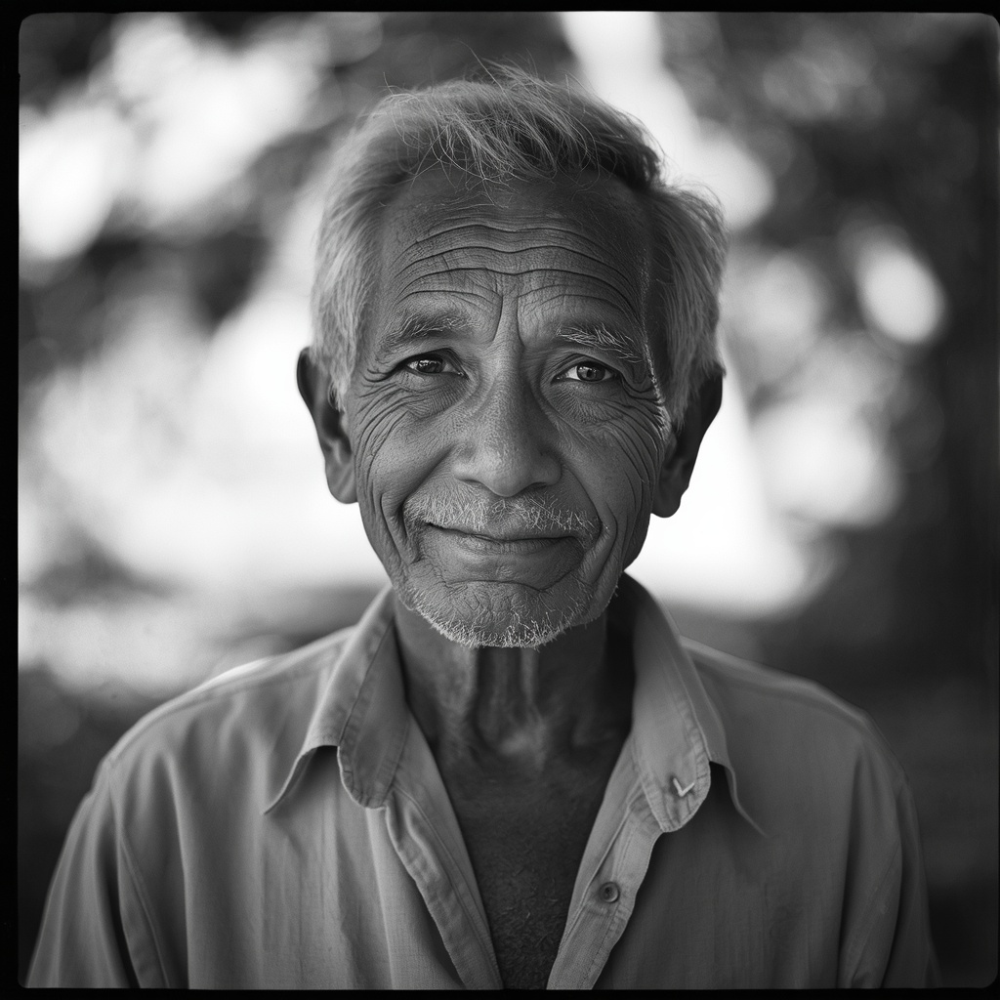
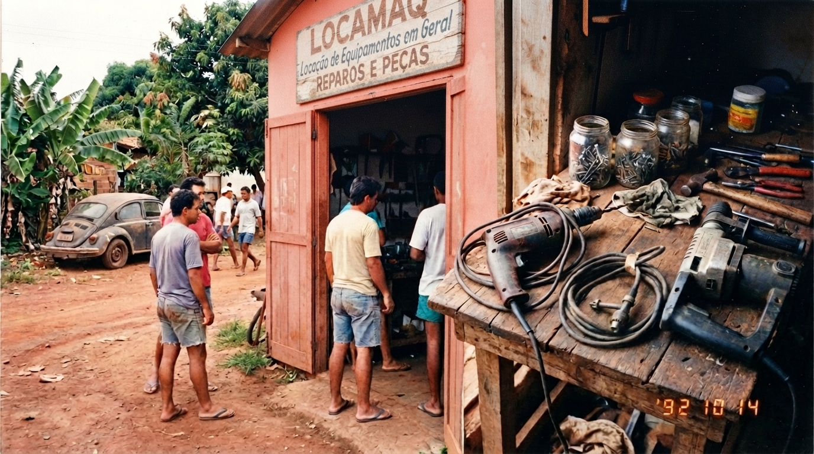
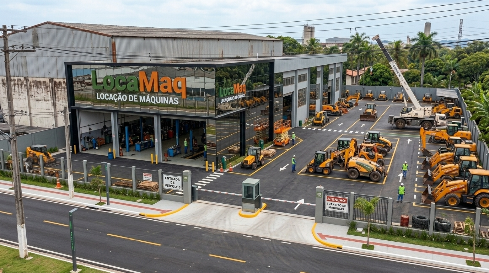

# Quem Somos - LocaMaq

> **Aviso:** a LocaMaq é uma empresa fictícia, criada para um case de portfólio. Pessoas, fatos e imagens deste texto são ilustrativos. As imagens foram geradas por IA.

## Nossa história

**1.** Em Sorocaba, todo mundo conhecia o seu José da Cunha. Cumprimentava a vizinhança pelo nome e nunca deixava ninguém ir embora sem um cafezinho. Tinha uma caixa de ferramentas de dar gosto, e quando o vizinho pedia a furadeira emprestada, a resposta era sempre a mesma: "Pode levar, mas devolve inteira!"

**2.** Em 1992, de tanto o povo bater no portão, o seu José montou um barracão pequeno só para aquilo. Passou a cobrar uns trocados por dia e a guardar tudo para comprar mais ferramenta. Furadeira, parafusadeira, martelete: o que o freguês pedia, ele dava um jeito de ter.

**3.** O negócio foi crescendo no boca a boca. Vieram os geradores, as empilhadeiras, as plataformas elevatórias. Em 2016 chegou a primeira máquina pesada, e dali em diante a frota não parou mais. Foi aí que a LocaMaq saiu de Sorocaba rumo a Campinas, Ribeirão Preto, São José dos Campos e São Paulo.

**4.** Hoje são 5 unidades e 117 equipamentos ativos, de escavadeiras a guindastes. O tamanho mudou, mas o jeito é o do primeiro empréstimo: equipamento certo, na hora certa e devolvido do jeito que a gente entregou.

## Missão

Oferecer equipamentos e máquinas pesadas em locação, com qualidade, segurança e pontualidade, para que nossos clientes executem suas obras e operações com tranquilidade.

## Visão

Ser a locadora de máquinas pesadas mais confiável do interior paulista e da Grande São Paulo, pela disponibilidade da frota e pela excelência na gestão de ativos.

## Valores

- **Confiança:** nossa palavra vale tanto quanto o contrato.
- **Pontualidade:** a obra do cliente não pode esperar.
- **Cuidado com o equipamento:** máquina bem mantida rende mais e é mais segura.
- **Segurança:** de quem opera, de quem trabalha ao redor e de quem contrata.
- **Relacionamento próximo:** atenção de vizinho a cada cliente.
- **Melhoria contínua:** medimos, aprendemos e evoluímos.

---

## Notas de projeto (não publicar no site)

**Origem dos números.** Vêm de `data/processed/cadastro_equipamentos.csv`, gerado com seed 42: 135 equipamentos cadastrados, 117 ativos, em 7 segmentos. Ativos por filial: São Paulo 31, Sorocaba 29, Campinas 24, Ribeirão Preto 22, São José dos Campos 11. A primeira aquisição do cadastro é de fevereiro de 2016, daí o marco de 2016. O ano de 1992 é só da narrativa e não aparece nos dados. Se os geradores forem rodados de novo e os números mudarem, atualizar o parágrafo 4.

**Matriz.** Sorocaba é a cidade de origem e a matriz. Esta é uma escolha de narrativa, não está nos dados.

**Paleta sugerida** (não vem dos dados):

| Uso | Cor | Hex |
|---|---|---|
| Verde-musgo | principal | `#4A5D3A` |
| Laranja queimado | destaque | `#C8651B` |
| Marrom terra | apoio | `#6B4A32` |
| Areia | fundo | `#E8DCC4` |
| Azul-petróleo | complementar discreto | `#2F5D62` |

**Pendências nas imagens** (revisadas em 30/10/2026).
- `02_barracao_1992.jpg`: substituída em 30/10/2026 por uma imagem nova (o arquivo veio como "Generated Image October 30, 2026 - 5_25AM.jpg" e foi renomeado). O letreiro agora é legível, mas diz "Locação de Equipamontos em Geral" (erro: "Equipamentos") e "Reparos e peças", que não está na história. O script `src/site/otimizar_imagens.py` corta o letreiro na versão do site; se quiser mostrá-lo, gerar de novo com o texto exato "LOCAÇÃO DE FERRAMENTAS" ou "sinal pintado à mão, sem texto legível".
- `03_unidade_atual.jpg`: as máquinas continuam amarelas. Gerar de novo com máquinas em laranja queimado e detalhes verde-escuros, para respeitar a paleta. O letreiro principal ("LocaMaq / Locação de Máquinas") está correto; o secundário, à direita, saiu com letras embaralhadas.

**Mural de 2016** (`07_2016.jpeg`, de 31/10/2026). Ilustra o slide 2016 do site. Os bilhetes grandes estão corretos ("O começo… no boca a boca, de Sorocaba!", "Maio de 2016 – Nossa primeira máquina pesada! Um marco!", "Rumo a novos horizontes!"); os textos miúdos saíram embaralhados (ficha "maio 2016", "Sõo" e "RUDODASN" no mapa, placas das fotos de baixo, cartão LocaMaq). Só ficam visíveis com a imagem ampliada.

**Missão, Visão e Valores** (imagens de 31/10/2026). `04_Missão.jpeg`, `05_Visão.jpeg` e `06_Valores.jpeg` são o fundo dos slides de mesmo nome no site, sob um véu translúcido. Os rótulos escritos em `06_Valores.jpeg` estão corretos. Em `05_Visão.jpeg`, o crachá no uniforme do homem à direita tem letras embaralhadas; no site quase não aparece.

**Imagens de portfólio (frota).** Lista dos 7 equipamentos, modelo de prompt e nomes de arquivo em `docs/prompts_imagens_frota.md`. Sem citar marcas ou modelos reais, que geradores de imagem erram.
